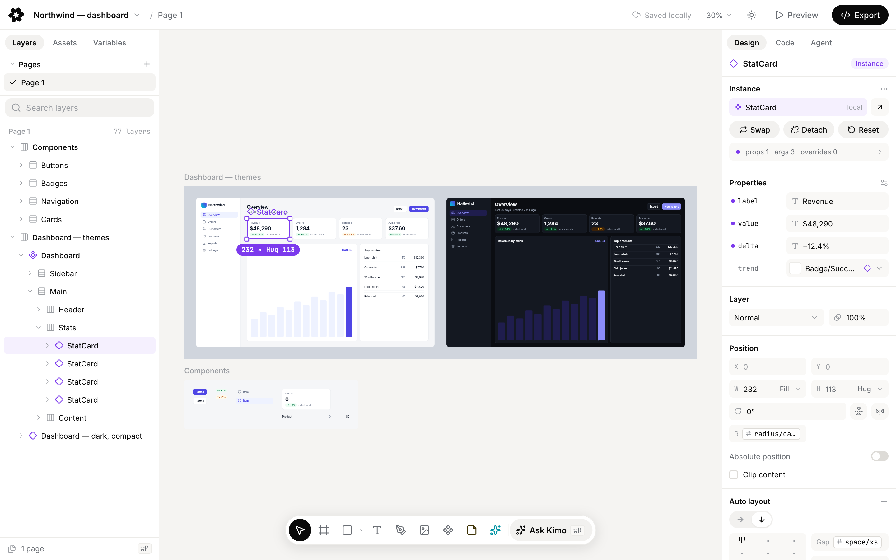
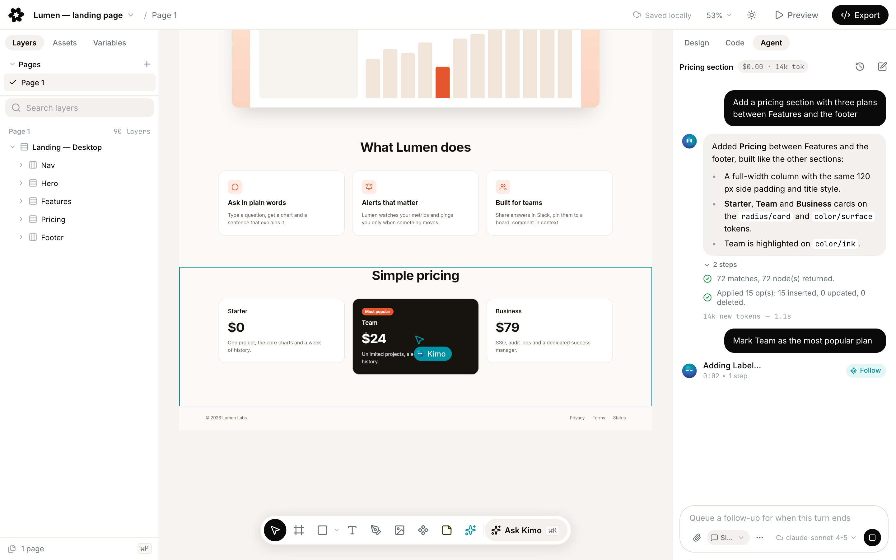
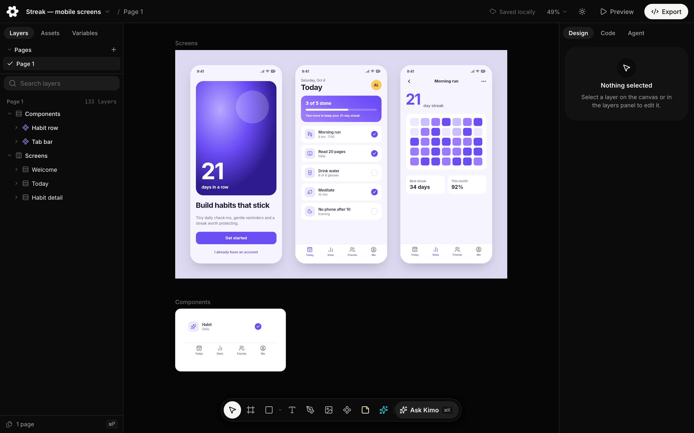

<p align="center">
  
</p>

# Kimo

Kimo is an open-source design canvas that you and your coding agents edit together, an
MIT-licensed alternative to pen.dev. Designs are `.kimo` files in your repository, plain JSON
that diffs and merges in git. It runs on your machine or in your browser, with no account and no
backend.

<p align="center">
  
</p>

- **A fast canvas.** WebGL rendering, auto layout, components and variants, variables and
  themes, with Figma-like selection and shortcuts.
- **Files that live in git.** `.kimo` is a published, versioned format laid out as a flat node
  table. The `kimo merge` git driver merges changes node by node and keeps real conflicts in the
  file for you to resolve in Kimo.
- **Agents built in.** Coding agents edit open documents through an MCP server with typed tools.
  The built-in agent works with Claude by default or any provider you add, with your own key or a
  local agent CLI.
- **Deterministic code export.** React + Tailwind, HTML/CSS, design tokens, SVG, PNG and PDF,
  generated by code rather than prompts.
- **Web and desktop.** The same editor in the browser and as a desktop app for macOS, Windows and
  Linux.
- **No account.** Everything works offline, with no sign-in and no metering.

<p align="center">
  
</p>

<p align="center">
  
</p>

## Try it

- **In your browser:** [kimo.design/app](https://kimo.design/app/). Files stay in the browser
  until you save them to disk.
- **Desktop app:** download the installer for macOS, Windows or Linux from
  [GitHub Releases](https://github.com/Saudade-media/kimo/releases).

The [user guide](docs/guide/getting-started/install.md) covers installing, the first file and
what differs between the web and desktop apps. The [examples](examples/) are ready to open.

## Develop

Requires [Bun](https://bun.sh), the only supported package manager.

```sh
bun install                    # install all workspaces
bun --filter @kimo/web dev     # run the web editor (Vite)
bun --filter @kimo/desktop dev # run the desktop app
bun run check                  # lint, typecheck, generated files and tests
```

The desktop app also needs Rust and the
[Tauri v2 prerequisites](https://v2.tauri.app/start/prerequisites/) for your OS. See
[CONTRIBUTING](CONTRIBUTING.md) for the check pipeline, commit style and design changes.

## Docs

- [User guide](docs/guide/getting-started/install.md)
- [Architecture](docs/architecture.md): principles, packages and dependency rules
- [`.kimo` format spec 1.0](docs/spec/kimo-format-1.0.md)
- [Agent guides](docs/agents/index.md): the MCP tools and the `.kimo` model for coding agents
- [`kimo` CLI](packages/cli/README.md)
- [Docs index](docs/README.md), [ADRs](docs/adr/README.md), [changelog](CHANGELOG.md)
- The website, kimo.design, renders these docs from this repository; its code lives in
  [Saudade-media/kimo-site](https://github.com/Saudade-media/kimo-site) (private)
- [Contributing](CONTRIBUTING.md), [Code of Conduct](CODE_OF_CONDUCT.md),
  [Security policy](SECURITY.md)

## License

[MIT](LICENSE). Third-party notices are in [NOTICE](NOTICE). "pen.dev" and "Pencil" are
trademarks of their owners; Kimo is not affiliated with them.
